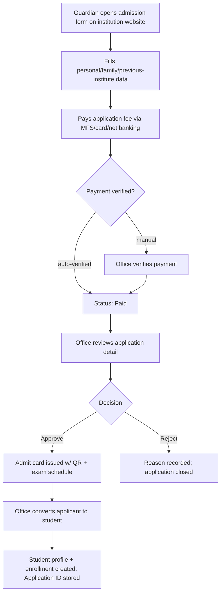
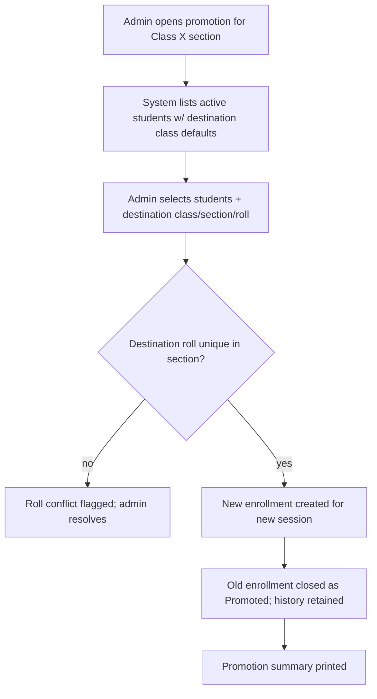
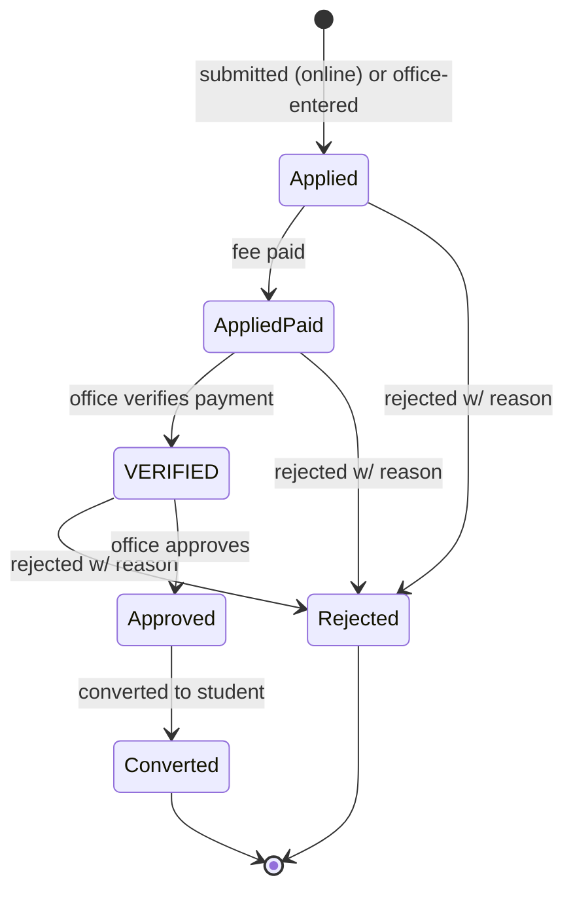
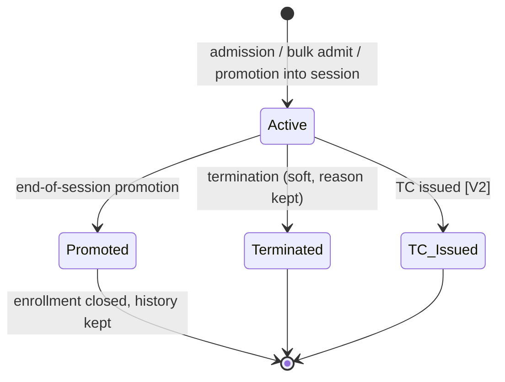

# Students Module — Product Requirements Document (PRD)

## Document Control

| Field | Details |
| --- | --- |
| Module | Students |
| Product | Biddakool |
| Document Type | Product Requirements Document |
| Document Status | Draft for Review |
| Version | 1.0 |
| Last Updated | 2026-11-18 |
| Document Owner | [To be assigned] |
| Related Documents | ["Students-features.md"](Students-features.md) (index), ["Students-v1-features.md"](versions/Students-v1-features.md) (authoritative V1 list), ["Students-business-rules.md"](Students-business-rules.md), ["Students-user-stories.md"](Students-user-stories.md), ["Students-workflows.md"](Students-workflows.md), ["Students-v1-scope.md"](versions/Students-v1-scope.md) |

### Revision History

| Version | Date | Summary of Changes |
| --- | --- | --- |
| 1.0 | 2026-11-18 | Fully authored from the benchmark research (["biddakool_features_list.md"](../../research/biddakool_features_list.md) §2.1–§2.9). Replaces the template placeholder. |

---

# 1. Product Overview

## 1.1 Vision

Every institution using Biddakool keeps **one trustworthy digital identity per student** — created at first application, enriched through admission, and reused by every other module (fees, attendance, exams, communication, portals) for the student's entire stay. The Students module is that identity core: the admission pipeline that onboards students and the 360° profile that answers "who is this child, where are they enrolled, and how do we reach their family?" in one screen.

## 1.2 Problem Statement

Bangladeshi schools and colleges manage student identity with paper admission forms, registers, and spreadsheets. The consequences, confirmed by the benchmark research (["biddakool_features_list.md"](../../research/biddakool_features_list.md) §2.1, §2.3):

- **No single source of truth.** The same student's data lives in the admission register, the class roll book, the fee ledger, and the exam sheets — with different spellings, missing fields, and no history.
- **Admission is slow and error-prone.** Manual form sale, cash fee handling, manual verification, re-typing into registers. Guardians travel to campus multiple times for a task that is mostly data entry.
- **Family data is scattered.** Guardian contacts, occupations, and income live in headmasters' notebooks — invisible when the office must send an SMS about dues or absence.
- **History is lost.** Promotions, terminations, and transfers overwrite the previous year's record; "which class was this student in during 2024?" is unanswerable.
- **Bulk operations don't exist.** Migrating 400 students into a new session means 400 manual entries.

## 1.3 Product Objectives

1. Digitize the **full admission pipeline** — application, fee, verification, approval, conversion — for both online (guardian-entered) and office-entered paths.
2. Maintain a **360° student profile** covering identity, enrollment, contacts, family, personal, admission info, device identity, and previous institute.
3. Make the student list the institution's **operational index** — deep filters, bulk tools, exports, and summaries.
4. Carry students safely across years with **promotion and termination** workflows that preserve history.
5. Expose **clean, permission-gated data** to every consuming module (Fees, HR attendance, Academics, Exams, Communication, Portals).

## 1.4 MVP Goals

- A new institution can record its students — individually, or in bulk by CSV — and issue each a unique identity.
- A guardian can apply online, pay the application fee digitally, and be approved without visiting the office until admission day.
- The office can verify, approve, and convert an applicant into a student in under two minutes.
- A teacher can pull up any student's 360° profile and act on it (SMS, password reset, profile download) within their permission set.
- End-of-session promotion moves a whole class to the next class with rolls and history intact.

## 1.5 MVP Non-Goals

- Certificates (TC/testimonial/course completion) and ID cards — **V2** (["Students-v2-features.md"](versions/Students-v2-features.md)).
- Student leaves — **V2** (STU-LEA-001).
- Membership records (সদস্যতা) — **Parked** (TOC-only in benchmark; scope never shown).
- Employment workflows — the HR module owns teacher/staff records and recruitment.
- Teaching content (routines, lessons, syllabus) — the Academics module owns it; Students only references.
- Fee collection itself — the Fees module owns it; Students' profile actions link to it.

## 1.6 Target Market and Business Types

- Bangladeshi **schools and colleges** — Bangla Medium, English Version, English Medium — single campus or multi-branch.
- Per the product direction confirmed 2026-11-18: school + college only; the madrasa/Hifz vertical and the medical-college edition are **out of scope for now** (["roadmap.md"](../roadmap.md) §6).
- Sizes: 200–5,000 students per institution; single-shift and multi-shift.

## 1.7 Market Benchmark and Differentiation [Proposed]

Benchmark: the **EximusEdu brochure** (["biddakool_features_working.md"](../../research/biddakool_features_working.md)) — a 200+ institution EMS in Bangladesh. Its student-side chapter (pp. 11–21) is the strongest evidence for this module's feature set: online admission with fee verification, deep-filtered student lists with bulk CSV/photo/update tools, 360° profiles with QR vCard and device IDs, tags, promotion/termination, certificates and ID cards.

Biddakool's deliberate differences in this module:

| # | Difference | Rationale |
|---|---|---|
| 1 | Certificates and ID cards deferred to V2 | Core identity value ships first; document generation is polish, not pipeline |
| 2 | One-family guardian model from day one (one guardian record referenced by siblings) | Avoids duplicate-contact chaos the benchmark's per-student family fields invite (BR-STU-PRF-004 [Pending OQ-STU-04]) |
| 3 | Application IDs and Institute User IDs follow documented, stable formats | The benchmark shows IDs everywhere (admit cards, SMS, portals) but never their generation rules |

# 2. Users and Personas

## 2.1 User Personas

| Persona | Role | Situation | What they need from Students |
|---|---|---|---|
| **Rahim — Institution Admin** | Principal / director's IT admin | Runs a 1,800-student school across 2 branches; answers for data quality | Trustworthy records, bulk tools, promotion runs, permission-controlled staff access |
| **Nusrat — Admissions Officer** | Office staff | Handles 60 admission forms per season at the front desk | Fast application capture, fee verification, one-click conversion |
| **Kamal — Guiding Teacher** | Class/guiding teacher | Owns 45 students' pastoral care | Class-filtered student list, 360° profile view, guardian contact, SMS, profile download |
| **Salma — Guardian** | Parent, low-tech comfort | Wants admission without queueing; wants to reach the school about her two children | Online application, fee payment receipt, child profiles |
| **Imran — Student** | Student, secondary level | Checks own record via portal | Correct profile data, ID card (V2), certificate (V2) |

## 2.2 User Roles and Responsibilities

| Role | Responsibilities in Students |
|---|---|
| Institution Admin | Configure settings (identity prefixes, tags, enums), manage all students, run promotion/termination, bulk tools |
| Admissions Officer | Application intake (office-entered), fee verification, approve/reject, conversion |
| Guiding Teacher | View class students, view profiles, send SMS (per permission), download profile, recommend termination |
| Guardian | Submit online application, pay application fee, view own children's profiles (via Portals) |
| Student | View own profile (via Portals) |
| Platform Support | Cross-tenant support read (Foundation IAM governs) |

## 2.3 User Permissions — High-Level

Granular permission enforcement (View/Add/Edit/Delete per action) is catalogued in Foundation (FND-AUTH-002). Module-level defaults for Students:

| Action | Admin | Admissions Officer | Guiding Teacher | Guardian | Student |
|---|---|---|---|---|---|
| Application intake (office) | ✓ | ✓ | — | — | — |
| Fee verify / approve / reject | ✓ | ✓ | — | — | — |
| Convert to student | ✓ | ✓ | — | — | — |
| Create/edit student | ✓ | — | — | — | — |
| View 360° profile | ✓ | ✓ | class-scoped ✓ | own children ✓ | own ✓ |
| Promote / Terminate | ✓ | — | — | — | — |
| Reset password / Send SMS | ✓ | ✓ (SMS) | per permission | — | — |
| Bulk tools (CSV/photo/update) | ✓ | — | — | — | — |
| Tags management | ✓ | — | — | — | — |

PII fields (guardian NID, family income, addresses) additionally require the PII-view permission (BR-STU-PRF-003).

## 2.4 Success Metrics

| Metric | Target |
|---|---|
| Time from application approval to student record | < 2 minutes |
| Bulk CSV import success rate on first run | ≥ 95% of rows |
| Profile fields populated at conversion (minimum set, BR-STU-PRF-001) | 100% |
| Admission-season office visits per applicant (online path) | 0 before admission day |

# 3. Product Scope and Requirements

## 3.1 MVP Scope

Section map (functional areas × features; authoritative rows in ["Students-v1-features.md"](versions/Students-v1-features.md)):

| Area | V1 Features | Summary |
|---|---|---|
| Admissions (STU-ADM) | STU-ADM-001…005 | Online/office applications, fee + verification, list & detail, admit card, conversion |
| Profiles (STU-PRF) | STU-PRF-001…008 | 360° profile, guardians & family, list & filters, bulk tools, QR vCard, siblings, segmentation fields, profile actions |
| Tags (STU-TAG) | STU-TAG-001 | Color-coded tags with set/not-set filters |

## 3.2 Functional Requirements — High-Level

| ID | Requirement | Feature |
|---|---|---|
| FR-STU-01 | Guardians can submit admission applications online with fee payment; the office can enter applications with a fee-adjust path | STU-ADM-001 |
| FR-STU-02 | Applications are manageable as a filterable list with approve/reject, form sale, bulk update, print/PDF/Excel | STU-ADM-002 |
| FR-STU-03 | Application detail shows payment, contact, family, personal, and previous-institute data | STU-ADM-003 |
| FR-STU-04 | Approved applicants receive a printable admit card with QR and admission-exam schedule | STU-ADM-004 |
| FR-STU-05 | Approved applicants convert into students; the application ID is stored in the profile | STU-ADM-005 |
| FR-STU-06 | Each student has a 360° profile: IDs/enrollment, contacts, family, personal, admission info, device identity, previous institute, enrolled subjects | STU-PRF-001 |
| FR-STU-07 | Guardian & family records hold parents' NID/occupation, family income, emergency contacts | STU-PRF-002 |
| FR-STU-08 | The student list supports deep filters, Students + Admissions summaries, and exports | STU-PRF-003 |
| FR-STU-09 | Bulk tools: Bulk Admit CSV, Bulk Photo Upload, Bulk Update | STU-PRF-004 |
| FR-STU-10 | QR vCard is available on the profile | STU-PRF-005 |
| FR-STU-11 | Siblings surface as mini-profiles | STU-PRF-006 |
| FR-STU-12 | Residential/coaching status and guiding-teacher fields segment students for other modules | STU-PRF-007 |
| FR-STU-13 | Profile actions: promote, terminate, reset password, send SMS, download profile (+ welcome card) | STU-PRF-008 |
| FR-STU-14 | Color-coded student tags with set/not-set list filters | STU-TAG-001 |

## 3.3 Non-Functional Requirements

| ID | Requirement |
|---|---|
| NFR-STU-01 | Student list renders with deep filters across 5,000 students in ≤ 3 s (pagination + indexed filters) |
| NFR-STU-02 | PII (guardian NID, income, addresses) encrypted at rest; PII-view permission required to display (BR-STU-PRF-003 [Pending OQ-STU-02]) |
| NFR-STU-03 | Every create/edit/delete/promote/terminate/status change writes an audit event (actor, timestamp, before/after) |
| NFR-STU-04 | All tenant data is institution-scoped; cross-branch visibility is a permission question, never a data-leak default |
| NFR-STU-05 | Exports (PDF/Excel/print) reproduce the on-screen filter state, not a hidden default |
| NFR-STU-06 | Bulk CSV import processes 1,000 rows without timeout; row-level error report is downloadable |
| NFR-STU-07 | Profile action side effects (SMS, fees, password) delegate to owning modules via integration contracts; Students never re-implements them |
| NFR-STU-08 | Age is computed from DOB and displayed precisely ("14y 2m 1d") |

## 3.4 Cross-Cutting Requirements

- **Audit:** per NFR-STU-03; audit is read-only, retained, and filterable (Foundation owns the trail infra).
- **Permissions:** per §2.3; enforced server-side, hidden client-side.
- **Tenancy:** every record carries the institution (and branch where applicable).
- **Error handling:** validation errors are field-level; integration failures (SMS gateway) are retried/dead-lettered by the Communication module, not by Students.

## 3.5 Localization Requirements [Proposed]

- UI supports **Bangla + English**; student-facing documents (admit card V1; certificates V2) follow bilingual Bangladeshi conventions.
- Names may contain Bangla script; database and exports are Unicode-safe (see FND-STR-001's Bengali dimensions).
- Bangla date rendering (Bangla calendar months) applies to documents only if requested [Pending — validate with pilot institutions].

## 3.6 Out-of-Scope Requirements

- Certificates & documents (TC, testimonial, course completion) — **V2** (STU-DOC-001…004).
- Student ID cards — **V2** (STU-DOC-002 within the certificates family; HR-DOC-001 covers teacher/staff cards).
- Student leaves — **V2** (STU-LEA-001).
- Membership records — **Parked** (["Students-features.md"](Students-features.md) §3).
- Attendance, fees, exams, lessons — owned by their modules; Students stores only the *identity* those modules reference (device IDs, enrollment, tags).

# 4. Core Concepts and Flows

## 4.1 Core Principles

1. **One identity, many enrollments.** The *student* is the long-lived identity; each academic year creates an *enrollment* (session + branch + shift + class + section + roll). History is never overwritten (BR-STU-GEN-002).
2. **Applications are first-class records.** Every application gets an immutable Application ID; conversion stores it in the profile — the audit trail from applicant to student is permanent (BR-STU-ADM-002).
3. **Minimal mandatory data, rich optional data.** Creating a student requires only the minimum set (BR-STU-PRF-001); everything else enriches the profile at the institution's pace.
4. **Soft lifecycle.** Students are promoted, transferred, or terminated — never silently deleted; Delete is an explicit, permission-gated, audited action (BR-STU-GEN-003).
5. **Students are a data hub, not a do-everything module.** Fees, SMS, passwords, attendance are *actions on the profile* executed by the owning modules.

## 4.2 Core Business Flows

### Flow A — Online admission (happy path)

### Flow B — End-of-session promotion

## 4.3 High-Level Object Lifecycles

### Application status machine

Statuses: `Applied`, `Applied+Paid`, `VERIFIED`, `Approved`, `Rejected`, `Converted`. `Converted` is terminal and immutable; timestamps are recorded on every transition (WF-STU-002).

### Enrollment lifecycle

Enrollment = (session, branch, shift, class, section, roll). A student has **at most one Active enrollment per session** (BR-STU-GEN-002).

## 4.4 Numbering and Documents [Proposed]

| Artifact | Format [Proposed] | Notes |
|---|---|---|
| Application ID | `APP-<session>-<seq>` e.g. `APP-2027-0142` | Unique per institution; immutable; stored in profile after conversion (BR-STU-ADM-002 [Pending OQ-STU-10]) |
| Institute User ID | `<branch>-<session>-<seq>` e.g. `B1-2027-00871` | Unique per institution (BR-STU-GEN-001); format needs product confirmation |
| Welcome card / profile PDF | Generated server-side, branded, PDF/image download | STU-PRF-008 |
| Admit card (admission exam) | Printable + QR, fee and schedule block | STU-ADM-004 |

## 4.5 Module Dependencies

### Upstream — Students depends on

| Dependency | Nature of dependency |
|---|---|
| ["Foundation"](../Foundation/README.md) | Institution structure (session/branch/shift/class/section/group — FND-STR-001), IAM & permissions (FND-AUTH-001/002), settings & enums (FND-SET-001), notifications (FND-NOT-*) |
| ["Fees"](../Fees/README.md) | Application-fee heads and collection status (FEE-*); profile action "Collect Fees" delegates to Fees |
| ["Communication"](../Communication/README.md) | Send-SMS profile action delegates to the SMS engine (COM-SMS-*); auto-triggers (admission exam notices) |

### Downstream — modules that depend on Students

| Consumer | What it consumes |
|---|---|
| ["HR"](../HR/README.md) | Attendance device identity (Device User ID, card/finger number — BR-STU-PRF-006 [Pending OQ-STU-09]); guiding-teacher linkage |
| ["Academics"](../Academics/README.md) | Enrollment (class/section/roll) for routines and lessons; guiding-teacher assignment |
| ["Exams"](../Exams/README.md) | Enrollment + residential/coaching segmentation (STU-PRF-007) for result reports |
| ["Operations"](../Operations/README.md) | Residential status for hostel allocation (V2) |
| ["Communication"](../Communication/README.md) | Guardian contacts for auto-SMS (attendance, dues, admission notices) |
| ["Portals"](../Portals/README.md) | Student/guardian dashboard identity banner, profile page, sibling mini-profiles (POR-STU-*) |

# 5. Acceptance Criteria — Module Level

| ID | Criterion |
|---|---|
| AC-STU-01 | A guardian can complete an online application and pay the fee without any office interaction; the application appears in the office list as `Applied+Paid` |
| AC-STU-02 | An approved applicant can be converted into a student with one action, producing a profile + enrollment and storing the Application ID |
| AC-STU-03 | A 1,000-row bulk CSV import completes with a downloadable row-level error report; no valid row is dropped |
| AC-STU-04 | Promotion of a class moves every selected student to the destination class with unique rolls and preserved history |
| AC-STU-05 | Any user without PII-view permission cannot read guardian NID/income/addresses anywhere in the UI or exports |
| AC-STU-06 | Terminating a student removes them from active lists but preserves the full profile and history |

# 6. User Experience Summary

## 6.1 Navigation and Module Structure

- Sidebar: **Students** → Applications (Online Applications list/detail), Students (list), Tags.
- Profile actions live on the profile page header; bulk tools live on the student list toolbar.

## 6.2 Dashboard and Key Information

- Office home surfaces: today's new applications, pending verifications, pending approvals (feeds into the Admissions summary — STU-PRF-003).
- Admin home surfaces: total students, per-branch/shift/class counts, bulk-tool shortcuts.

## 6.3 Common UX Principles

- Filters persist per user session; "clear filters" is always visible.
- Lists are the primary surface; profiles open as full pages (deep-linkable).
- Destructive actions (Terminate, Delete) always show a typed/checkbox confirmation and cite the rule that governs them.
- Bangla-first labels with English equivalents for the two-language user base.

# 7. Technical Blueprint Summary

**Rule: deliberately stack-agnostic.** Concrete technology decisions belong in `01-architecture/` ADRs, never here.

## 7.1 Multi-Tenancy

- All rows are tenant-scoped by institution; branch-scoping applies where branch is part of the record (enrollment, tags per OQ-STU-07).
- Cross-tenant access is impossible by query construction, not by filtering convention (Foundation FND-AUTH-* enforces).

## 7.2 Data Integrity and Audit Trail

- Enrollment history is append-only; status changes are new rows/events, not edits.
- Audit events per NFR-STU-03; Application IDs and Institute User IDs are immutable once issued.

## 7.3 Integration Readiness

- **Contracts out:** student identity + enrollment snapshot; guardian contact list; segmentation fields (residential/coaching/guiding teacher); device identity.
- **Contracts in:** application fee status (Fees); SMS delivery results (Communication); device provisioning events (HR/attendance).
- Payment/portal/public-website integrations consume Portals' surfaces; Students stays headless for those flows.

# 8. Delivery Plan

## 8.1 MVP Implementation Priorities

Identity core first (profiles + list), then the admission pipeline, then bulk tools and polish. Detail in ["Students-v1-scope.md"](versions/Students-v1-scope.md) (M0–M6).

## 8.2 Dependencies and Build Order

- Blocks on Foundation's structure + IAM (FND-STR-001, FND-AUTH-001/002).
- Admission fee dependency (FEE-*) can start behind a feature flag; applications without fee heads use the office fee-adjust path.
- SMS profile action depends on Communication's engine; ship behind the engine's availability.

# 9. Risks and Constraints

## 9.1 Business Risks

| Risk | Mitigation |
|---|---|
| Institutions resist digital applications (paper habit) | Office-entered path + form sale covers the transition; CSV bulk import eases data migration |
| Family data entered by guardians is low quality | Office verification step before approval; mandatory-minimum rule (BR-STU-PRF-001) |
| Duplicate students from bulk import | Row-level duplicate checks on Institute User ID + roll (BR-STU-BLK-001) |

## 9.2 Technical Risks

| Risk | Mitigation |
|---|---|
| Roll uniqueness scope assumptions wrong for some institutions | Roll uniqueness is per (Session, Class, Section) [Proposed]; revisit with pilot data (BR-STU-GEN-001) |
| PII encryption complicates search | PII fields are never search targets in V1 lists (search by name/ID/phone); keeps encryption simple (BR-STU-PRF-003) |
| Sibling detection produces false positives | Default key = father NID; fallback guardian phone requires manual confirm (BR-STU-PRF-004 [Pending OQ-STU-04]) |

## 9.3 Regulatory and Compliance Risks

| Risk | Mitigation |
|---|---|
| Guardian NID retention rules unknown | OQ-STU-02 open; encryption default until resolved |
| Student data retention after termination | OQ-STU-03 open; default retain-indefinitely, archive from active lists |

# 10. Open Questions

All resolved by the product owner on 2026-11-18 (D-STU-06). OQ-STU-06's error policy is confirmed; its exact CSV schema will be proposed for review before the M4 build milestone.

| ID | Question | Affected | Resolution (2026-11-18) |
|---|---|---|---|
| OQ-STU-01 | May a TC be issued while fee dues remain outstanding? | BR-STU-DOC-001 (V2), STU-DOC-001 | Blocked while dues remain; dues-waiver permission can override |
| OQ-STU-02 | What encryption/retention applies to guardian NID and family income? | BR-STU-PRF-003, NFR-STU-02 | Encrypt at rest; PII-view permission to read |
| OQ-STU-03 | How long are terminated/graduated records retained? | BR-STU-GEN-004 | Retain indefinitely; hidden from default list filters |
| OQ-STU-04 | What key links siblings? | BR-STU-PRF-004, STU-PRF-006 | Father NID primary; guardian-phone fallback requires office confirmation |
| OQ-STU-05 | Are application fees refundable on rejection? | BR-STU-ADM-004 | Non-refundable |
| OQ-STU-06 | Exact Bulk Admit CSV schema and error policy? | BR-STU-BLK-001, STU-PRF-004 | Error policy confirmed (row-level; valid rows import, failures reported); exact schema proposed at M4 |
| OQ-STU-07 | Are tags shared across branches or branch-scoped? | BR-STU-TAG-001, STU-TAG-001 | Shared institution-wide |
| OQ-STU-08 | Re-admission of a terminated student — same ID or new ID? | BR-STU-GEN-003, STU-PRF-008 | New ID; original profile linked as history |
| OQ-STU-09 | Who owns device identity maintenance — Students or HR? | BR-STU-PRF-006 | Students stores it on the profile; HR consumes it |
| OQ-STU-10 | Final Application ID and Institute User ID formats | BR-STU-ADM-002, BR-STU-GEN-001 | `APP-<session>-<seq>` / `<branch>-<session>-<seq>` |

# 11. Decision Log [Proposed]

| ID | Decision | Date | Rationale | Alternatives rejected |
|---|---|---|---|---|
| D-STU-01 | Certificates, ID cards, and leaves are V2, not V1 | 2026-11-18 | Identity pipeline is the core value; document generation is polish | Include in MVP (rejected: doubles document-template work before identity is proven) |
| D-STU-02 | Membership (সদস্যতা) parked, not scoped | 2026-11-18 | TOC-only in benchmark; scope never shown (["Students-features.md"](Students-features.md) §3) | Speculate scope (rejected: violates honest-placeholder rule) |
| D-STU-03 | One-family guardian model — guardian records shared by siblings | 2026-11-18 | De-duplicates contacts; enables guardian-sees-all-children (POR-STU-010) | Per-student family records (rejected: duplicates, inconsistent data) |
| D-STU-04 | Enrollment is separate from student identity | 2026-11-18 | History preservation (BR-STU-GEN-002); multi-session facts | Single-record overwrite (rejected: loses history) |
| D-STU-05 | TC/testimonial/ID-card features follow Students data model but land in V2 | 2026-11-18 | They depend on a stable identity core | Parallel build (rejected: churn risk) |

# 12. Future Scope (Post-MVP)

## Release 2 (R2)

["Students-v2-features.md"](versions/Students-v2-features.md): certificates & documents (STU-DOC-001…004 — TC bilingual, testimonial multilingual, course-completion, ID cards), student leaves (STU-LEA-001). R2 planning opens when V1 tracker approaches Done.

## Release 3 (R3)

No Students features in R3 (["Students-v3-features.md"](versions/Students-v3-features.md) is empty). Parked: STU-MEM-001 (Membership) pending domain validation.

# 13. Glossary

| Term | Meaning |
|---|---|
| Application | An admission application record; becomes a student on conversion |
| Application ID | Immutable unique ID issued per application (BR-STU-ADM-002) |
| Enrollment | A student's placement in one session: branch/shift/class/section/roll |
| Institute User ID | The student's permanent identity within the institution (BR-STU-GEN-001) |
| 360° profile | The full student record view: identity, enrollment, contacts, family, personal, admission, device, previous institute |
| Guardian | Father, mother, or legally responsible contact; may be a portal login (Portals module) |
| Guiding teacher | Staff member assigned pastoral responsibility for a student (STU-PRF-007) |
| Residential status | Resident / non-resident (hostel linkage, Operations; result segmentation, Exams) |
| Tag | Admin-defined, color-coded label for list segmentation (STU-TAG-001) |
| TC | Transfer Certificate (V2, BR-STU-DOC-001) |
| Bulk Admit CSV | Row-level bulk import creating students + enrollments (STU-PRF-004) |
| PII | Personally identifiable information (NID, income, addresses) |

# 14. Assumptions, Constraints and Dependencies

## 14.1 Assumptions

- Guardian records are shared per family (D-STU-03); a guardian may also be a portal login (Portals).
- Roll uniqueness per (Session, Class, Section) [Proposed — validate with pilot data].
- The admission-exam schedule shown on admit cards is maintained outside this module ( Academics/office admin) and referenced at print time [Proposed].
- Application fees are configured as fee heads in the Fees module (FEE-PLN-*).

## 14.2 Constraints [Proposed]

- Bangladesh education-board conventions govern bilingual documents (TC V2) — validate templates at build time.
- No PII in list exports by default (BR-STU-PRF-003).

## 14.3 Dependencies [Proposed]

- Foundation structure + IAM must be live before any Students build milestone (see §4.5).
- Communication SMS engine needed for the Send-SMS profile action; integration graceful if unavailable.

# 15. Related Documentation

| Document | Purpose |
|---|---|
| ["Students-PRD.md"](Students-PRD.md) | Why the module exists and what it covers. (This document.) |
| ["Students-features.md"](Students-features.md) | Module feature index — maps and counts version catalogs. |
| ["Students-v1-features.md"](versions/Students-v1-features.md) | Authoritative V1 feature catalog (14 features). |
| ["Students-business-rules.md"](Students-business-rules.md) | The rules the system must enforce (`BR-STU-*`). |
| ["Students-user-stories.md"](Students-user-stories.md) | Realistic scenarios that exercise the module. |
| ["Students-workflows.md"](Students-workflows.md) | Step-by-step processes and status transitions. |
| ["Students-v1-scope.md"](versions/Students-v1-scope.md) | V1 scope, build order (M0–M6), status tracker. |
| ["roadmap.md"](../roadmap.md) | Global tiered rollup (Students: 14 R1 / 5 R2 / 0 R3 / 1 parked). |

# Appendix A: Benchmark Mapping and MVP Decisions [Proposed]

| Benchmark evidence (["biddakool_features_list.md"](../../research/biddakool_features_list.md)) | Biddakool decision |
|---|---|
| §2.1 Online admission: application + fee + verification, list filters, approve/reject, form sale, bulk update, print/PDF/Excel | STU-ADM-001/002/003 (V1) |
| §2.1 Admit card with QR + admission-exam schedule | STU-ADM-004 (V1, Should Have) |
| §2.1 Approved applicant → student conversion; application ID stored | STU-ADM-005 (V1) |
| §2.3 Student list deep filters, summaries, bulk CSV/photo/update | STU-PRF-003/004 (V1) |
| §2.3 360° profile incl. QR vCard, device IDs, guiding teacher, tags, siblings | STU-PRF-001/002/005/006/007 (V1) |
| §2.3 Profile actions: promote/terminate/reset password/SMS/download + welcome card | STU-PRF-008 (V1) |
| §2.3 Tags system, color-coded | STU-TAG-001 (V1) |
| §2.6 Student leaves w/ comments/attachments/status lifecycle | STU-LEA-001 (V2) |
| §2.7 Certificates: TC bilingual, testimonial, course completion, watermark | STU-DOC-001…003 (V2) |
| §2.8 ID cards (student variant; teacher variant in HR) | STU-DOC-004 (V2); HR-DOC-001 (HR V2) |
| §2.9 Membership (সদস্যতা) TOC-only | Parked (STU-MEM-001) — D-STU-02 |
