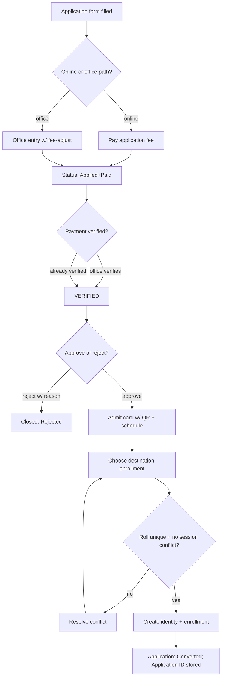
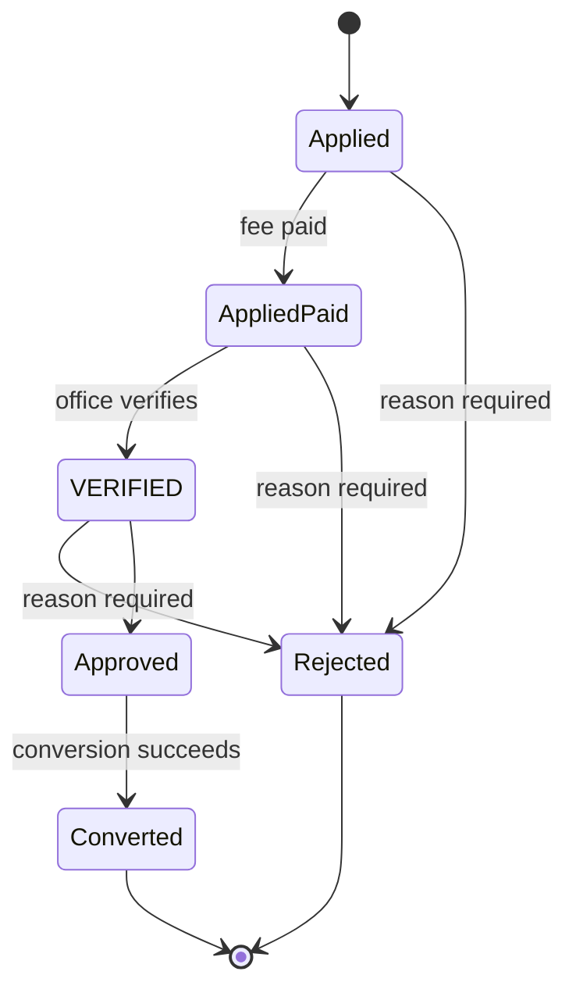
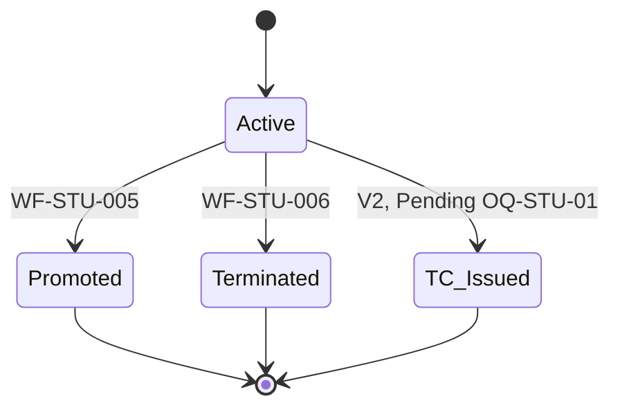

# Students Module — Workflows

## Document Control

| Field | Details |
|---|---|
| Module | Students |
| Product | Biddakool |
| Document Type | Workflows |
| Document Status | Draft for Review |
| Version | 1.0 |
| Last Updated | 2026-11-18 |
| Related Documents | ["Students-PRD.md"](Students-PRD.md), ["Students-features.md"](Students-features.md), ["Students-v1-features.md"](versions/Students-v1-features.md), ["Students-business-rules.md"](Students-business-rules.md), ["Students-user-stories.md"](Students-user-stories.md), ["Students-v1-scope.md"](versions/Students-v1-scope.md) |

### Revision History

| Version | Date | Summary |
|---|---|---|
| 1.0 | 2026-11-18 | Fully authored: 6 workflows covering admission, application lifecycle, enrollment lifecycle, bulk import, promotion, termination. Replaces the template placeholder. |

---

# 1. Document Information

## 1.1 Purpose

This document describes how work is performed in the Students module: how each task starts, which phases it passes through, what decisions are made at each phase, what the system produces, and what the final outcome is.

It translates the version catalogs and Business Rules into ordered business processes. **It does not define new scope, new rules, or new behavior.**

**Important:** Where this document and the Business Rules document conflict, the Business Rules document is authoritative. Where priority, release, or approval status conflicts, the version catalogs are authoritative. A story's or workflow's priority never promotes a feature.

## 1.2 Scope

- All workflows supported by the V1 catalog (["Students-v1-features.md"](versions/Students-v1-features.md)).
- The V2 termination→TC branch is noted where it touches V1 behavior and clearly marked.

## 1.3 Terminology and Workflow Elements

| Element | Meaning |
|---|---|
| Workflow | An end-to-end business process, identified as `WF-STU-<nnn>`. |
| Phase | A major stage of a workflow. |
| Task | An individual action performed inside a phase, by a person or the system. |
| Milestone | A point of verifiable completion inside a workflow. |
| Decision Point | A choice that determines which path the workflow follows. Numbered `D1, D2, …` inside each workflow. |
| Expected Result | What the system must produce at the end of a phase. |
| Exception Path | What happens when a task or validation fails. |
| Completion Summary | The final outcome of the workflow. |

### Status Labels Used in This Document

| Label | Meaning |
|---|---|
| `[Proposed]` | The related requirement is suggested but not approved. |
| `[Pending]` | The behavior depends on an unresolved product decision (PRD §10). |
| `[Verify]` | The behavior requires validation against official sources. |
| `[Conditional]` | The workflow applies only if the related feature is approved for R1. |

### Depth Levels

| Depth | Content |
|---|---|
| Full | Complete A–E structure with a Mermaid diagram. Used for the main transaction lifecycles. |
| Medium | Complete A–E structure with compact phases. Used for configuration and support workflows. |
| Light | A–E structure with a summarized phase list. Used for view, tracking, and cross-cutting workflows. |

# 2. Workflow Overview

A workflow's priority and release never promote a feature. Priority, release, and approval status remain governed by ["Students-v1-features.md"](versions/Students-v1-features.md).

| ID | Workflow | Group | Depth | Status |
|---|---|---|---|---|
| WF-STU-001 | Online admission end-to-end | Admissions | Full | Active |
| WF-STU-002 | Application lifecycle & office review | Admissions | Full | Active |
| WF-STU-003 | Enrollment lifecycle | Profiles | Full | Active |
| WF-STU-004 | Bulk Admit CSV import | Bulk tools | Medium | Active |
| WF-STU-005 | End-of-session promotion | Profiles | Medium | Active |
| WF-STU-006 | Termination (and TC branch [V2]) | Profiles | Medium | Active |

# 3. Workflows

## WF-STU-001 — Online admission end-to-end (Full)

**Trigger:** guardian opens the institution's admission form on the public website (Portals POR-WEB-001 / POR-ADM-001) or the office starts an office-entered application.

### A. Phases and Tasks

**Phase 1 — Application capture**
- Task 1.1 (Guardian): fill personal, contact, family, previous-institute data; choose class/session.
- Task 1.2 (System): validate required fields; reserve an Application ID (BR-STU-ADM-002) on final submit.
- Task 1.3 (Office, office path): enter the same data on the admin side with the fee-adjust option.

**Phase 2 — Fee payment**
- Task 2.1 (System/Guardian): collect the application fee via Fees (MFS/card/net banking).
- Task 2.2 (System): mark the application `Applied+Paid`; issue payment reference.
- Task 2.3 (Office, where manual): verify the payment → `VERIFIED` (BR-STU-ADM-001).

**Phase 3 — Office review**
- Task 3.1 (Officer): open application detail (STU-ADM-003); check family/PII per permission.
- Task 3.2 (Officer): Approve or Reject with reason (BR-STU-ADM-005).
- Task 3.3 (Officer, [Conditional] STU-ADM-004): print admit card with QR + admission-exam schedule.

**Phase 4 — Conversion**
- Task 4.1 (Officer/Admin): choose destination enrollment (session/branch/shift/class/section/roll).
- Task 4.2 (System): run BR-STU-GEN-001/002, BR-STU-ADM-003, BR-STU-PRF-001 checks.
- Task 4.3 (System): create identity + enrollment + family link; stamp admitted-on; store Application ID; close application as `Converted`.

### B. Decision Points

| # | Decision | Rule |
|---|---|---|
| D1 | Was the fee paid (auto-verified vs manual)? | BR-STU-ADM-001 |
| D2 | Approve or Reject? | BR-STU-ADM-005 (reject needs reason) |
| D3 | Is the destination roll free and the session conflict-free? | BR-STU-GEN-001, BR-STU-GEN-002 |

### C. Expected Results

- After Phase 2: application visible in the office list as `Applied+Paid`/`VERIFIED` with timestamps.
- After Phase 3: `Approved` (with admit card available) or `Rejected` (with reason, closed).
- After Phase 4: student profile + active enrollment exist; application is `Converted`; audit trail links the two.

### D. Exception Paths

- Payment fails/cancelled → application stays `Applied`; guardian can retry payment; no conversion.
- Duplicate submission (same applicant data) → flagged for office review; no auto-merge [Proposed].
- Roll conflict at conversion → D3 fails; system refuses and shows the conflicting enrollment (STU-ADM-005 AC1).
- Missing guardian contact → conversion refused until minimum data satisfied (BR-STU-PRF-001).

### E. Completion Summary

An applicant becomes a student with a permanent, auditable chain: Application ID → Institute User ID → first enrollment. Guardian SMS (login credentials / welcome) can fire via Communication auto-triggers (COM-AUT-*).

## WF-STU-002 — Application lifecycle & office review (Full)

**Trigger:** any application exists in the system.

### A. Phases and Tasks

**Phase 1 — Status engine**
- Task 1.1 (System): enforce the status machine — `Applied` → `Applied+Paid` → `VERIFIED` → `Approved` → `Converted`; `Rejected` reachable from any pre-conversion state; every transition stamped (actor, timestamp).

**Phase 2 — Office worklist**
- Task 2.1 (Officer): filter the applications list (status/session/class/…); process rows (STU-ADM-002).
- Task 2.2 (Officer): verify payments, approve, reject, bulk-update, export.

**Phase 3 — Immutability guard**
- Task 3.1 (System): `Converted` and `Rejected` are terminal; Application IDs never change (BR-STU-ADM-002/005).

### B. Decision Points

| # | Decision | Rule |
|---|---|---|
| D1 | Can this application be approved now? | Requires paid/verified payment (BR-STU-ADM-001/003) |
| D2 | Is this a rejection? | Reason mandatory (BR-STU-ADM-005) |

### C. Expected Results

Every application's status timeline is complete and auditable from the detail page (STU-ADM-003).

### D. Exception Paths

- Illegal transition attempted (e.g. approve unpaid) → refused with rule citation.
- Concurrent edit conflict → last-writer-wins blocked; officer re-loads and reapplies [Proposed].

### E. Completion Summary

The office always knows why an application is where it is; rejected applicants re-apply with a fresh ID.

## WF-STU-003 — Enrollment lifecycle (Full)

**Trigger:** conversion (WF-STU-001), bulk admit (WF-STU-004), or promotion (WF-STU-005).

### A. Phases and Tasks

**Phase 1 — Enrollment creation**
- Task 1.1 (System): create enrollment = (session, branch, shift, class, section, roll) with uniqueness checks (BR-STU-GEN-001/002).

**Phase 2 — Active life**
- Task 2.1 (Consuming modules): read the active enrollment for attendance, fees, exams, routines, portals.
- Task 2.2 (Office): edit non-identity fields (section transfer within class [Proposed]; device identity per BR-STU-PRF-006 [Pending OQ-STU-09]).

**Phase 3 — Closure**
- Task 3.1 (System/Admin): close as `Promoted` (WF-STU-005), `Terminated` (WF-STU-006), or `TC_Issued` [V2, Pending OQ-STU-01].
- Task 3.2 (System): history retained; student hidden from default lists (BR-STU-GEN-004).

### B. Decision Points

| # | Decision | Rule |
|---|---|---|
| D1 | Is there already an active enrollment for this (student, session)? | BR-STU-GEN-002 |
| D2 | Which closure state? | Promotion vs termination vs TC [V2] |

### C. Expected Results

One active enrollment per student per session, full enrollment history on the 360° profile.

### D. Exception Paths

- Second active enrollment attempt → refused with the existing enrollment shown.
- Closure blocked (e.g. dues for TC [V2]) → per BR-STU-DOC-001.

### E. Completion Summary

Identity survives; enrollments tell the true year-by-year story.

## WF-STU-004 — Bulk Admit CSV import (Medium)

**Trigger:** admin opens Bulk Admit (STU-PRF-004) and uploads a CSV.

### A. Phases and Tasks

**Phase 1 — Upload & mapping**
- Task 1.1 (Admin): upload CSV; select target session/branch/shift.
- Task 1.2 (System): validate header vs the documented schema [Pending OQ-STU-06].

**Phase 2 — Row-level validation**
- Task 2.1 (System): validate each row: minimum data (BR-STU-PRF-001), existing class/section, unique Institute User ID, unique roll in (Session, Class, Section), no session conflict (BR-STU-GEN-001/002, BR-STU-BLK-001).

**Phase 3 — Import**
- Task 3.1 (System): create identity + enrollment + guardian atomically per valid row; batch audit entry.
- Task 3.2 (System): produce downloadable per-row error report for rejected rows.

**Phase 4 — Post-import review**
- Task 4.1 (Admin): open summary (imported/failed counts); fix and re-import failed rows.

### B. Decision Points

| # | Decision | Rule |
|---|---|---|
| D1 | Row valid? | BR-STU-BLK-001 |
| D2 | Existing family detected for the row's guardian key? | BR-STU-PRF-004 (link, don't duplicate) |

### C. Expected Results

All valid rows imported; zero partial rows; error report lists every rejected row with a precise reason.

### D. Exception Paths

- Header mismatch → import refuses before processing (nothing imported).
- Duplicate family keys → siblings linked rather than duplicated (D2).

### E. Completion Summary

Bulk migration of a real institution completes in one pass plus a small re-import of corrected rows.

## WF-STU-005 — End-of-session promotion (Medium)

**Trigger:** admin opens Promotion (STU-PRF-008) for a class/section (or selection).

### A. Phases and Tasks

**Phase 1 — Selection**
- Task 1.1 (Admin): pick source (session, class, section) → system lists active students with suggested destination class.

**Phase 2 — Destination mapping**
- Task 2.1 (Admin): set destination class/section; assign rolls (manual or sequential [Proposed]).
- Task 2.2 (System): validate roll uniqueness in destination (BR-STU-GEN-001).

**Phase 3 — Execution**
- Task 3.1 (System): create new enrollments; close old ones as `Promoted`; batch audit entry.
- Task 3.2 (Admin): print promotion summary.

### B. Decision Points

| # | Decision | Rule |
|---|---|---|
| D1 | Promote to next class, or hold/repeat? | Admin choice; repeating = new enrollment in the same class [Proposed] |
| D2 | Roll conflicts? | BR-STU-GEN-001 |

### C. Expected Results

Every promoted student has exactly one new active enrollment; old enrollments closed; history intact.

### D. Exception Paths

- Roll conflict → flagged per student; admin resolves before execution.
- Partial execution failure → per-student transactional result; retry only failed students [Proposed].

### E. Completion Summary

A whole class moves up in one run with zero data loss.

## WF-STU-006 — Termination (and TC branch [V2]) (Medium)

**Trigger:** admin opens Terminate on a profile (STU-PRF-008); TC issuance is the V2 variant (STU-DOC-001 [V2]).

### A. Phases and Tasks

**Phase 1 — Initiation**
- Task 1.1 (Admin): choose Terminate; system requests reason + effective date.

**Phase 2 — Safeguards**
- Task 2.1 (System): show outstanding dues (informational in V1; blocking only for TC [V2] per BR-STU-DOC-001 [Pending OQ-STU-01]).
- Task 2.2 (Admin): confirm with explicit checkbox.

**Phase 3 — Execution**
- Task 3.1 (System): close active enrollment as `Terminated`; record reason/actor/timestamp; audit.
- Task 3.2 (System): student leaves default lists (BR-STU-GEN-004); re-admission creates a NEW ID linked to the original profile as history [Pending OQ-STU-08].

### B. Decision Points

| # | Decision | Rule |
|---|---|---|
| D1 | Terminate with or without TC? | V1: termination only; TC path is V2 |
| D2 | Dues outstanding — inform or block? | V1 informs; TC blocks [Pending OQ-STU-01] |

### C. Expected Results

The student is inactive but never lost: profile, enrollments, and the termination record remain reachable.

### D. Exception Paths

- Confirmation missing → no state change.
- Re-admission requested later → new ID path per BR-STU-GEN-003.

### E. Completion Summary

Departures are recorded, reversible in data terms (history preserved), and auditable.

# 4. Assumptions

- Application status names (`Applied`, `Applied+Paid`, `VERIFIED`, `Approved`, `Rejected`, `Converted`) match the brochure vocabulary; final UI labels may differ in Bangla [Verify].
- Promotion runs are per class/section in V1; institution-wide one-click rollover is a later convenience [Proposed].
- The admission-exam schedule on admit cards is maintained outside this module and referenced at print time [Proposed].
